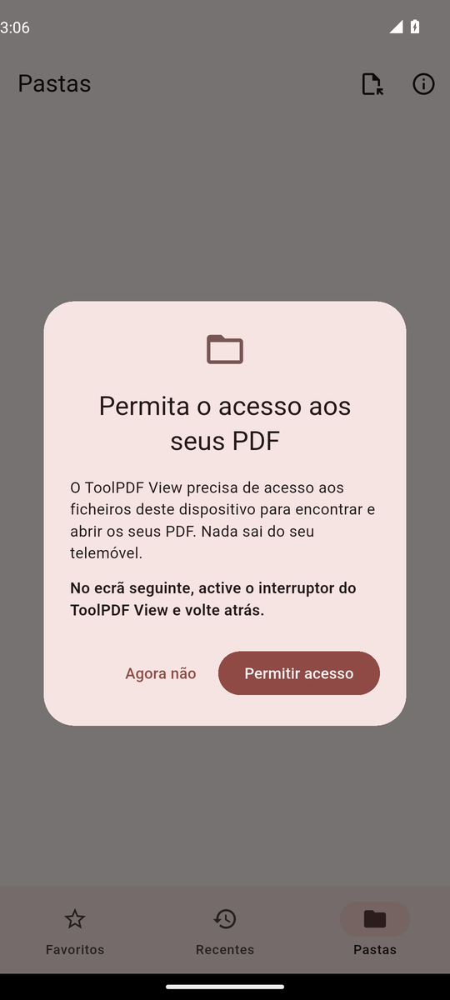
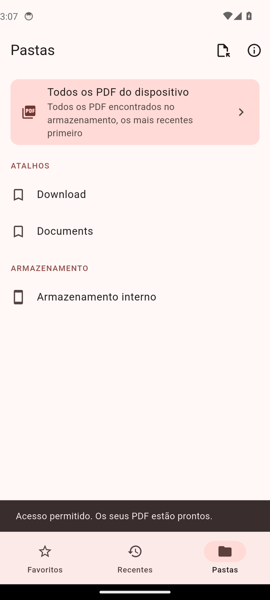
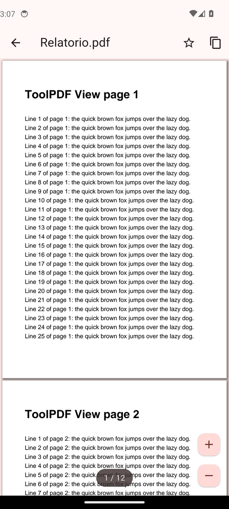
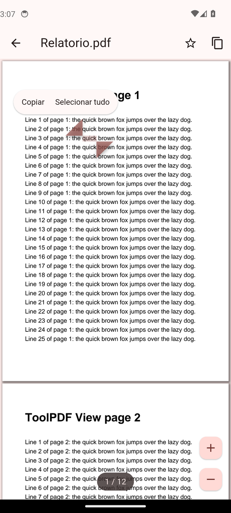

# ToolPDF View

Um leitor de PDF simples, rápido e sem anúncios para Android, feito em Flutter.
Faz parte da família de ferramentas de [toolpdf.org](https://toolpdf.org), por
**Edivaldo Jorge** ([@jorgeedvaldo](https://github.com/jorgeedvaldo)).

Todo o projecto — código, chaves de assinatura e automação — é público de
propósito: serve também de exemplo completo de como se publica uma app Android.

## O que faz

- Abre qualquer PDF do telemóvel, com **zoom de dois dedos** (ou duplo toque) e
  **selecção e cópia de texto**: toque longo sobre uma palavra → Copiar. O
  botão de cópia da barra superior copia o texto da página ou do documento
  inteiro de uma só vez.
- Três separadores: **Favoritos**, **Recentes** e **Pastas** (explorador do
  armazenamento do dispositivo), com **Todos os PDF do dispositivo** numa única
  lista pesquisável por nome.
- Pede o acesso aos ficheiros logo na primeira abertura, uma única vez. Quem
  preferir não o dar pode abrir ficheiros um a um pelo selector do sistema.
- Abre PDF protegidos por palavra-passe e salta para qualquer página (toque no
  indicador de página).
- Fica registado no Android como aplicação para abrir PDFs: ao tocar num PDF no
  WhatsApp, Gmail, Downloads ou num gestor de ficheiros, o ToolPDF View aparece
  em "Abrir com".
- Sem anúncios, sem rastreio, sem permissão de Internet. Nada sai do aparelho.
- Línguas: inglês, português, espanhol, francês e russo.

| | |
| --- | --- |
| ID da aplicação | `com.toolodfview.app` |
| SDK mínimo | Android 7.0 (API 24) |
| Motor de PDF | [pdfrx](https://pub.dev/packages/pdfrx) (PDFium) |
| Arquitecturas | arm64-v8a e armeabi-v7a (as dos telemóveis) |

## Gerar o APK e o AAB

O workflow [`.github/workflows/ci.yml`](.github/workflows/ci.yml) faz
tudo, e corre sozinho a cada envio de código para uma branch de
desenvolvimento. Para o correr à mão no GitHub: separador **Actions** →
**Build release (APK + AAB)** → **Run workflow**, indicando opcionalmente a
versão (ex.: `1.0.1`) e o código de versão (ex.: `2`).

O workflow analisa o código, corre todos os testes (ver [Testes](#testes)),
compila e — só se tudo passar — grava os ficheiros assinados na pasta
[`releases/`](releases) na raiz do repositório:

```
releases/toolpdf-view-<versão>-<código>.apk   → instalar directamente no telemóvel
releases/toolpdf-view-<versão>-<código>.aab   → carregar na Google Play Console
```

O APK serve qualquer telemóvel Android (ARM de 32 e 64 bits). Pela Play
Store, o AAB entrega a cada aparelho só o que ele precisa, por isso a
transferência fica à volta de metade do tamanho do APK.

Os mesmos ficheiros ficam também disponíveis como *artifacts* da execução. Um
`git push` de uma tag `v*` (ex.: `v1.0.1`) corre o mesmo workflow e cria ainda
uma GitHub Release.

### Publicar na Google Play

1. Correr o workflow e descarregar `releases/*.aab`.
2. Na Play Console, criar a app com o ID `com.toolodfview.app` e carregar o AAB.
3. Deixar o **Play App Signing** activado (predefinição): o Google passa a
   guardar a chave de assinatura final e a chave deste repositório fica apenas
   como chave de *upload*.
4. Na declaração de permissões, explicar o uso de `MANAGE_EXTERNAL_STORAGE`
   ("All files access"): serve para o separador *Pastas* listar os PDF do
   dispositivo. Quem não quiser conceder a permissão continua a poder abrir
   ficheiros pelo selector do sistema — a app funciona na mesma.
5. Ícone da listagem: [`assets/icon/play_store_512.png`](assets/icon).

Cada envio para a Play precisa de um `versionCode` maior que o anterior — use o
campo *Version code* ao correr o workflow.

### Chaves de assinatura

A chave de release está em [`android/keystore/`](android/keystore) e as
credenciais em [`android/key.properties`](android/key.properties):

| | |
| --- | --- |
| Keystore | `android/keystore/toolpdfview-release.jks` |
| Alias | `toolpdfview` |
| Palavra-passe (keystore e chave) | `toolpdfview` |
| Validade | até 2054 |
| SHA-256 | `3D:2D:C9:0C:E7:67:09:8C:6B:4A:08:BD:E7:D9:F3:CA:9F:99:40:1D:7A:69:D0:E5:7B:C7:AD:9F:A6:CF:F0:5D` |

São públicas por opção, para qualquer pessoa poder reproduzir a compilação.
Como são públicas, qualquer pessoa pode assinar um APK que o Android aceita como
actualização desta app — por isso o Play App Signing (ponto 3 acima) é
importante. Para substituir a chave por uma privada: gerar outra com
`keytool -genkeypair -keystore android/keystore/toolpdfview-release.jks -alias
toolpdfview -keyalg RSA -keysize 2048 -validity 10000`, actualizar
`android/key.properties` e manter ambos fora do repositório.

## Testes

Três níveis, todos corridos pelo workflow antes de qualquer compilação ser
guardada:

| Nível | O que verifica | Como correr |
| --- | --- | --- |
| Unitários e de widgets ([`test/`](test)) | Favoritos e recentes, pesquisa de PDF, pedido de acesso na primeira abertura, traduções, ecrã de erro | `flutter test` |
| Integração ([`integration_test/`](integration_test)) | A app a correr no motor gráfico real com o PDFium real: abrir, zoom, ir para página, PDF com palavra-passe, ficheiro corrompido, e **toque longo → Copiar nas cinco línguas** | `xvfb-run -a flutter test integration_test -d linux` |
| Ponta a ponta ([`tool/e2e_android.py`](tool/e2e_android.py)) | O APK de release num emulador Android em português, usado como uma pessoa o usaria: conceder o acesso nas definições, navegar até Download, abrir um PDF, seleccionar e copiar, "abrir com" a partir de outra app | corre no workflow |

As capturas de ecrã do último teste de ponta a ponta ficam em
[`docs/screenshots/`](docs/screenshots):

| Primeira abertura | Pastas | Leitor | Copiar |
| --- | --- | --- | --- |
|  |  |  |  |

### O erro do ecrã cinzento (e porque há testes em cinco línguas)

Na versão 1.0.0, um toque longo sobre o texto cobria o documento com uma
caixa cinzenta — mas só em telemóveis que não estivessem em inglês. O motor de
PDF desenha o menu "Copiar" com o pacote `material_ui`, que procura as suas
traduções e só tinha reserva para inglês; em português a procura devolvia
nulo, o menu falhava ao ser construído e o Flutter, em modo release, mostra um
widget falhado como uma caixa cinzenta do tamanho do espaço que ocupa. Desde a
1.0.1 a app fornece essas traduções em todas as línguas, desenha o menu com os
seus próprios componentes e substitui a caixa cinzenta por uma mensagem curta —
e os testes de integração repetem o gesto em cada língua.

## Compilar localmente

Com o [Flutter](https://docs.flutter.dev/get-started/install) 3.47 ou mais
recente e o Android SDK instalados:

```bash
flutter pub get
flutter gen-l10n       # gera as traduções a partir de lib/l10n/*.arb
flutter test
xvfb-run -a flutter test integration_test -d linux   # precisa de libgtk-3-dev
flutter build apk --release
flutter build appbundle --release
```

## Estrutura

```
lib/
  main.dart                     arranque
  l10n/app_*.arb                traduções (en, pt, es, fr, ru)
  src/
    app.dart                    MaterialApp, tema, PDFs recebidos de outras apps
    theme.dart                  cores da marca
    screens/
      home_screen.dart          separadores e pedido de acesso inicial
      browse_tab.dart           explorador de pastas
      all_pdfs_screen.dart      todos os PDF do dispositivo, com pesquisa
      viewer_screen.dart        leitor: zoom, selecção e cópia de texto
      about_screen.dart         ecrã do programador
    services/
      library.dart              favoritos e recentes (guardados no aparelho)
      storage.dart              leitura de pastas e pesquisa de PDF
      storage_access.dart       estado da permissão de acesso aos ficheiros
      documents_channel.dart    ponte para o Android
    widgets/                    ícone desenhado em código, listas, ecrã de erro
android/app/src/main/
  AndroidManifest.xml           filtros "Abrir com" para PDF
  kotlin/.../MainActivity.kt    recebe PDFs de outras apps, permissões, selector
linux/                          alvo desktop, usado só pelos testes de integração
test/                           testes unitários e de widgets
integration_test/               testes no motor real (e os PDF de teste)
tool/
  generate_icons.py             gera os ícones (PDF branco sobre vermelho)
  generate_test_pdf.py          gera os PDF usados nos testes
  e2e_android.py                teste de ponta a ponta no emulador Android
```

## Ícone

Fundo vermelho `#D32F2F`, folha com canto dobrado e a palavra "PDF" a branco.
Para alterar: editar [`tool/generate_icons.py`](tool/generate_icons.py), correr
`python3 tool/generate_icons.py` e depois `dart run flutter_launcher_icons`.

## Licença

Código aberto, sob a licença MIT — ver [LICENSE](LICENSE).
